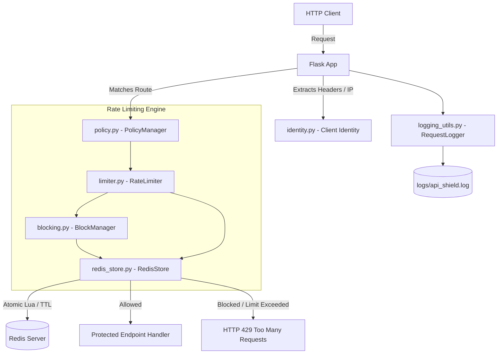
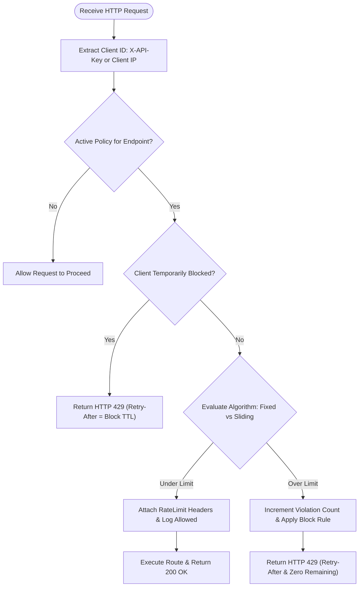

# API Shield – Simple API Rate Limiting System

An intern-friendly, production-grade rate limiting system for REST APIs built in Python with Flask and Redis. API Shield protects backend endpoints from excessive requests, abusive bursts, and credential stuffing attacks by enforcing configurable rate limit policies using atomic Fixed Window and Sliding Window algorithms.

---

## 1. System Architecture

API Shield sits between incoming HTTP traffic and protected business endpoints.



### Request Decision Flow (SRS Section 23)



---

## 2. Prerequisites & Redis Installation

- **Python**: 3.10+ (tested on Python 3.10, 3.11, 3.12, 3.13)
- **Redis**: 5.x+ or Memurai (Windows)

### Installing Redis

#### Windows
**Option A: Winget portable package (Recommended)**
```powershell
winget install taizod1024.redis-windows-fork --accept-source-agreements --accept-package-agreements
# Start Redis:
redis-server
```

**Option B: Memurai Developer**
Download and install [Memurai Developer](https://www.memurai.com/) (Redis 7+ compatible engine for Windows). It runs natively as a Windows service.

**Option C: Windows Subsystem for Linux (WSL)**
```bash
wsl --install
# Inside WSL Ubuntu:
sudo apt update && sudo apt install redis-server
sudo service redis-server start
```

#### macOS (Homebrew)
```bash
brew install redis
brew services start redis
```

#### Linux (Debian / Ubuntu)
```bash
sudo apt update
sudo apt install redis-server
sudo systemctl enable --now redis-server
```

---

## 3. Quick Start & Setup

### Clone and Create Virtual Environment

#### On Windows (PowerShell):
```powershell
# Clone or navigate to directory
cd api_shield

# Create virtual environment
python -m venv .venv
.\.venv\Scripts\Activate.ps1

# Install runtime and dev dependencies
pip install --upgrade pip
pip install -r requirements-dev.txt
```

#### On macOS / Linux (Bash):
```bash
cd api_shield
python3 -m venv .venv
source .venv/bin/activate
pip install --upgrade pip
pip install -r requirements-dev.txt
```

### Environment Configuration (.env)

Copy `.env.example` to `.env`:
```powershell
Copy-Item .env.example .env     # Windows
cp .env.example .env            # macOS / Linux
```

Configuration variables in `.env`:
| Variable | Default | Description |
|---|---|---|
| `APP_HOST` | `127.0.0.1` | Host interface for Flask server |
| `APP_PORT` | `5000` | Port for Flask server (1–65535) |
| `REDIS_HOST` | `localhost` | Hostname or IP of Redis server |
| `REDIS_PORT` | `6379` | Port for Redis server |
| `DEFAULT_LIMIT` | `10` | Fallback request limit (> 0) |
| `DEFAULT_WINDOW` | `60` | Fallback window duration in seconds (> 0) |
| `LOG_LEVEL` | `INFO` | Logging level (`DEBUG`, `INFO`, `WARNING`, `ERROR`) |
| `ADMIN_API_KEY` | *(Ephemeral)* | Secret key required in `X-Admin-Key` header |
| `VIOLATION_TTL_SECONDS` | `86400` | Retention period for violation counters (24h) |
| `POLICY_FILE` | `policies.json`| Local JSON path for persisted policies |
| `FAIL_OPEN` | `true` | When `true`, allow degraded traffic during Redis outages |
| `LOG_FILE` | `logs/api_shield.log` | Rotating log file location |

*Note*: If `ADMIN_API_KEY` is left blank in production, API Shield generates a cryptographically secure random key on boot and prints it once to console.

---

## 4. Running the System & Tasks

Using `tasks.ps1` (Windows PowerShell) or `make` (macOS/Linux):

| Action | PowerShell | Make | Direct Command |
|---|---|---|---|
| **Install** | `.\tasks.ps1 install` | `make install` | `pip install -r requirements-dev.txt` |
| **Run Server** | `.\tasks.ps1 run` | `make run` | `python app.py` |
| **Run Tests** | `.\tasks.ps1 test` | `make test` | `pytest --cov=. --cov-report=term-missing` |
| **Lint Check** | `.\tasks.ps1 lint` | `make lint` | `ruff check . && ruff format --check .` |
| **Auto-Format** | `.\tasks.ps1 format` | `make format` | `ruff check --fix . && ruff format .` |
| **Run Demo** | `.\tasks.ps1 demo` | `make demo` | `python scripts/demo.py` |

---

## 5. API Reference & cURL Examples

### 5.1 Unprotected Endpoints

#### `GET /health`
Returns health of Flask server and Redis ping status.
```bash
curl -i http://127.0.0.1:5000/health
```
```json
{
  "status": "healthy",
  "redis": "connected"
}
```

#### `GET /status`
Operational metrics and active policy count.
```bash
curl -i http://127.0.0.1:5000/status
```
```json
{
  "active_policies": 3,
  "redis_connected": true,
  "uptime_seconds": 128.45,
  "version": "1.0.0"
}
```

---

### 5.2 Protected Business Endpoints

Rate limits apply to these endpoints based on `policies.json`. Client is identified via `X-API-Key` (preferred) or Client IP.

#### `GET /api/products`
Protected by `product_limit` (5 requests / 60 seconds, Fixed Window).
```bash
curl -i -H "X-API-Key: client_alice" http://127.0.0.1:5000/api/products
```
Response headers on success:
```http
HTTP/1.1 200 OK
Content-Type: application/json
X-RateLimit-Limit: 5
X-RateLimit-Remaining: 4
X-RateLimit-Reset: 1700000060
```

Response when limit exceeded:
```http
HTTP/1.1 429 Too Many Requests
Content-Type: application/json
Retry-After: 48
X-RateLimit-Limit: 5
X-RateLimit-Remaining: 0
X-RateLimit-Reset: 1700000060

{
  "error": "Rate limit exceeded",
  "message": "Please try again later"
}
```

#### `GET /api/users`
Protected by `users_limit` (10 requests / 60 seconds, Sliding Window).
```bash
curl -i -H "X-API-Key: client_bob" http://127.0.0.1:5000/api/users
```

#### `POST /api/login`
Protected by `login_limit` (3 requests / 60 seconds, Fixed Window).
```bash
curl -i -X POST -H "Content-Type: application/json" \
  -H "X-API-Key: client_charlie" \
  -d '{"username": "admin", "password": "password123"}' \
  http://127.0.0.1:5000/api/login
```

---

### 5.3 Administrative Policy Endpoints (SRS 7.1)

All admin routes require `X-Admin-Key: <ADMIN_API_KEY>`. Admin routes are exempt from rate limiting.

#### List Policies
```bash
curl -i -H "X-Admin-Key: admin-secret-key-12345" http://127.0.0.1:5000/api/policies
```

#### Create Policy
```bash
curl -i -X POST -H "X-Admin-Key: admin-secret-key-12345" \
  -H "Content-Type: application/json" \
  -d '{
    "name": "checkout_limit",
    "endpoint": "/api/checkout",
    "limit": 5,
    "window": 60,
    "algorithm": "fixed_window",
    "active": true
  }' \
  http://127.0.0.1:5000/api/policies
```

#### View / Update Policy
```bash
# View
curl -i -H "X-Admin-Key: admin-secret-key-12345" http://127.0.0.1:5000/api/policies/checkout_limit

# Update
curl -i -X PUT -H "X-Admin-Key: admin-secret-key-12345" \
  -H "Content-Type: application/json" \
  -d '{"limit": 10, "window": 120, "algorithm": "sliding_window"}' \
  http://127.0.0.1:5000/api/policies/checkout_limit
```

#### Deactivate / Activate Policy
```bash
# Deactivate
curl -i -X POST -H "X-Admin-Key: admin-secret-key-12345" \
  http://127.0.0.1:5000/api/policies/checkout_limit/deactivate

# Activate
curl -i -X POST -H "X-Admin-Key: admin-secret-key-12345" \
  http://127.0.0.1:5000/api/policies/checkout_limit/activate
```

---

## 6. Redis Key Design Table

| Purpose | Key Pattern | Data Type | Value / Score | Expiry / Retention |
|---|---|---|---|---|
| **Fixed Window Counter** | `rate:<client>:<endpoint>:<window_num>` | String (Counter) | Integer request count | Window seconds (`EXPIRE`) |
| **Sliding Window Set** | `slide:<client>:<endpoint>` | Sorted Set (ZSET) | Score: epoch float<br>Member: `f"{ts}:{nonce}"` | `window + 1` seconds |
| **Violation Tracker** | `violation:<client>` | String (Counter) | Cumulative count | `VIOLATION_TTL_SECONDS` (24h) |
| **Temporary Block** | `block:<client>` | String | `"1"` | Tier duration (300s, 900s, 1800s) |

---

## 7. Rate Limiting Algorithm Comparison & Boundary Burst Note

| Characteristic | Fixed Window | Sliding Window |
|---|---|---|
| **Mechanism** | Buckets requests into static clock windows (`time // window`) | Records individual timestamps in Redis Sorted Set (`ZSET`) |
| **Memory Usage** | Minimal (single integer per client per active window) | Moderate (proportional to allowed requests in window) |
| **Boundary Accuracy** | Lower (susceptible to 2x burst across window edges) | High (smooth rolling time window) |
| **Typical Use Case** | Default general API endpoints, bulk operations | High-risk endpoints (checkout, authentication, logins) |

### The Fixed Window Boundary Burst Phenomenon
In a Fixed Window algorithm with limit = 5 per 60 seconds:
- A client sends 5 requests at `t = 59s` (Window 1 allows all 5).
- At `t = 60s`, Window 2 starts with a fresh counter.
- The client sends 5 more requests at `t = 61s` (Window 2 allows all 5).
- **Result**: The client performed 10 requests within a 2-second span (a **2x burst**), bypassing the intended throughput constraint.
Sliding Window resolves this by checking `now - 60s`, preventing boundary clustering.

---

## 8. Fail-Open vs Fail-Closed Policy

When the Redis data store experiences an outage:
- **`FAIL_OPEN=true` (Default)**: Requests are allowed to pass through to protect service availability. The server logs a `store_error` warning and attaches the HTTP header `X-RateLimit-Status: degraded`.
- **`FAIL_OPEN=false`**: Requests return `HTTP 503 Service Unavailable` with body `{"error": "Service Unavailable", "message": "Rate limiting backend unavailable"}` to guarantee strict limit enforcement above all else.

---

## 9. Design Decisions & SRS Enhancements

1. **Atomic Lua Scripts for Fixed Window**: The naive implementation (`incr` followed by `expire`) contains a critical race condition: if Redis or the worker crashes between the two calls, the key is immortal without a TTL. We execute INCR and EXPIRE in a single atomic Lua script to guarantee keys always have a TTL.
2. **Sub-Second Nonces in Sliding Window**: Redis Sorted Sets treat members with the same score and string value as duplicates. If a client sent two concurrent requests in the same millisecond, naive timestamps caused key collisions. We append a short hexadecimal nonce (`f"{now}:{uuid.uuid4().hex[:8]}"`) to ensure every request is individually counted.
3. **No Record on Reject in Sliding Window**: In the original SRS pseudocode, rejected requests were added to the Sorted Set. This could cause a malicious client to flood the set with rejected requests, artificially blocking legitimate future requests. In API Shield, rejected requests are NOT added to the Sorted Set.
4. **Anti-Self-Extending Temporary Blocks**: Repeated hits while a client is already blocked do not increment the violation count or reset the block timer. This prevents clients from being trapped in permanent denial-of-service.
5. **Privacy-Preserving SHA-256 Masking**: Sensitive API keys never appear in log files. Keys are transformed into `key:<first_2>***<sha256_prefix_6>`.
6. **Rejection of `X-Forwarded-For`**: `X-Forwarded-For` is trivially spoofed by untrusted clients. `request.remote_addr` is used exclusively unless behind an explicitly trusted proxy.
7. **Deterministic Policy Tie-Breaking**: If multiple active policies match the exact same endpoint, the most recently updated policy (`updated_at`) wins.
8. **Constant-Time Admin Authentication**: Admin keys are verified using `hmac.compare_digest` to eliminate timing attack vectors.

---

## 10. Known Limitations

1. **Fixed Window Boundary Burst**: As explained in Section 7, Fixed Window permits up to 2x the limit across clock boundaries.
2. **Single Redis Node as Single Point of Failure (SPOF)**: While fail-open prevents total downtime, a single Redis instance lacks automatic failover. (Redis Sentinel/Cluster was intentionally excluded per SRS Section 1.4).
3. **Local JSON File Policy Storage**: Policies are saved to a local file (`policies.json`). When scaled horizontally across multiple servers, policy updates on one node are not automatically broadcast to other nodes without shared storage.

---

## 11. Troubleshooting

- **`Redis store unavailable` on startup**: Ensure Redis is running locally (`redis-cli ping` returns `PONG`). On Windows, run `redis-server` from terminal.
- **Port 5000 in use**: Set `APP_PORT=5001` in `.env` or run with `APP_PORT=5001 python app.py`.
- **Admin requests return 401**: Check that the `X-Admin-Key` header matches `ADMIN_API_KEY` in `.env`.

---

## 12. Manual Test Guide (SRS Section 15 Walkthrough)

1. Start Redis: `redis-server`
2. Start Flask server: `python app.py`
3. Send 5 requests to `/api/products`:
   ```bash
   for i in {1..5}; do curl -i -H "X-API-Key: manual_tester" http://127.0.0.1:5000/api/products; done
   ```
   *Expected*: All 5 return `HTTP 200 OK` with decreasing `X-RateLimit-Remaining` (4, 3, 2, 1, 0).
4. Send 6th request:
   ```bash
   curl -i -H "X-API-Key: manual_tester" http://127.0.0.1:5000/api/products
   ```
   *Expected*: `HTTP 429 Too Many Requests`, `Retry-After: <seconds>`, `X-RateLimit-Remaining: 0`.
5. Check Redis Keys via `redis-cli`:
   ```bash
   redis-cli KEYS "rate:*"
   redis-cli TTL "rate:key:manual_tester:/api/products:<window_num>"
   ```
